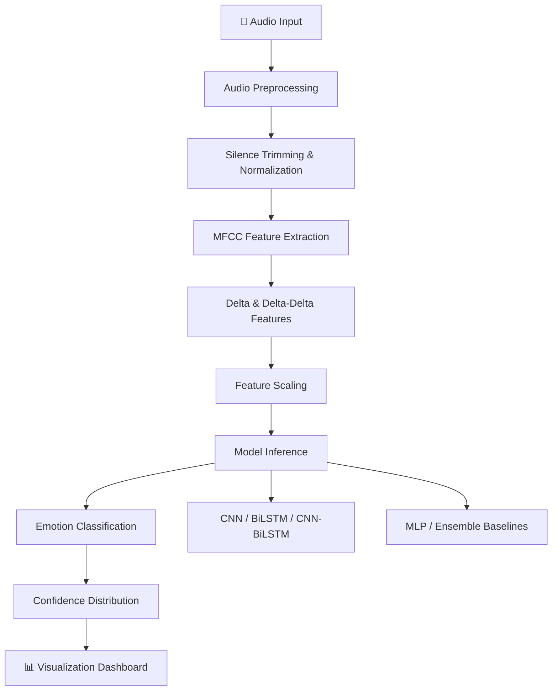

<div align="center">


<br/>


<br/><br/>

[](https://python.org/)
[](https://pytorch.org/)
[](https://gradio.app/)
[](https://scikit-learn.org/)

<br/>

[](https://github.com/vinay-venkat/CodeAlpha_Emotion-Recognition-from-Speech-/stargazers)
[](https://github.com/vinay-venkat/CodeAlpha_Emotion-Recognition-from-Speech-/forks)
[](https://github.com/vinay-venkat/CodeAlpha_Emotion-Recognition-from-Speech-/commits/main)

<br/>

**An AI-powered Speech Emotion Recognition system that analyzes vocal patterns and predicts human emotional states using Machine Learning and Deep Learning.**

</div>

---

## ✨ Overview

**Emotion Recognition from Speech (SER)** is an intelligent audio analysis project designed to identify emotions from human speech recordings.

The system processes voice signals, extracts meaningful acoustic characteristics, and uses trained machine learning and deep learning models to classify the emotional state expressed in speech.

It combines audio signal processing, neural network architectures, and an interactive Gradio interface to create an end-to-end Speech Emotion Recognition pipeline.

### 🎯 Project Highlights

- 🎙️ Live microphone recording and audio file uploads.
- 🧠 Multiple machine learning and deep learning architectures.
- 📊 MFCC-based acoustic feature extraction.
- 🔍 Emotion probability distribution.
- 📈 Speech waveform and MFCC visualization.
- ⚡ Interactive Gradio web interface.
- 🧪 Automated testing and model evaluation.
- 🔄 Speaker-aware dataset splitting to reduce data leakage.

---

## 🧠 Emotion Detection

The system is designed to recognize **7 emotional categories**.

<table>
<tr>
<td align="center" width="25%">
<h1>😄</h1>
<b>Happy</b>
<br/>Positive emotional expression
</td>
<td align="center" width="25%">
<h1>😢</h1>
<b>Sad</b>
<br/>Low-energy emotional expression
</td>
<td align="center" width="25%">
<h1>😡</h1>
<b>Angry</b>
<br/>High-intensity expression
</td>
<td align="center" width="25%">
<h1>😐</h1>
<b>Neutral</b>
<br/>Balanced expression
</td>
</tr>
<tr>
<td align="center">
<h1>😨</h1>
<b>Fearful</b>
<br/>Fear-related expression
</td>
<td align="center">
<h1>🤢</h1>
<b>Disgust</b>
<br/>Disgust-related expression
</td>
<td align="center">
<h1>😲</h1>
<b>Surprised</b>
<br/>Unexpected emotional response
</td>
<td align="center">
<h1>🎧</h1>
<b>Audio AI</b>
<br/>Speech analysis
</td>
</tr>
</table>

---

## ⚙️ System Architecture

The project follows an end-to-end machine learning pipeline.



### 🔬 Audio Feature Extraction

The system uses several acoustic features to represent speech.

| Feature | Purpose |
|---|---|
| MFCC | Represents the spectral characteristics of speech |
| Delta | Captures changes in MFCC features |
| Delta-Delta | Captures changes in the delta features |
| Spectral information | Helps characterize audio frequency patterns |
| Prosodic information | Helps describe vocal characteristics |

### 🤖 Machine Learning Models

The project supports multiple model architectures:

- **CNN:** Learns local patterns from acoustic features.
- **BiLSTM:** Captures temporal relationships in speech.
- **CNN-BiLSTM with Attention:** Combines convolutional feature learning with temporal modeling and attention.
- **MLP:** Provides a dense neural network baseline.
- **Ensemble:** Combines Deep MLP and Random Forest predictions.

The training pipeline supports model comparison and evaluation.

---

## 🛠️ Technology Stack

<div align="center">

| Category | Technologies |
|:---:|:---|
| Programming | Python |
| Deep Learning | PyTorch, TorchAudio |
| Machine Learning | Scikit-learn |
| Audio Processing | Librosa, SoundFile |
| Data Processing | NumPy, Pandas, SciPy |
| Visualization | Matplotlib, Seaborn |
| Web Interface | Gradio |
| Testing | Pytest |
| Development | Jupyter Notebook, VS Code |

</div>

---

## 📂 Project Structure

```text
Emotion Recognition from Speech/
│
├── app.py
├── requirements.txt
│
├── notebooks/
│   └── 01_eda_and_baseline.ipynb
│
├── scripts/
│   └── create_dummy_data.py
│
├── src/
│   ├── __init__.py
│   ├── config.py
│   ├── datasets.py
│   ├── features.py
│   ├── models.py
│   ├── train.py
│   ├── evaluate.py
│   └── predict.py
│
├── tests/
│   └── test_pipeline.py
│
├── data/
│   ├── raw/
│   │   ├── ravdess/
│   │   ├── tess/
│   │   └── emodb/
│   │
│   └── processed/
│
├── checkpoints/
│
└── outputs/
    ├── metrics.json
    ├── training_curves.png
    └── confusion_matrix.png
```

---

## 📚 Datasets

This project supports three publicly available speech emotion datasets.

### 1. RAVDESS

**Ryerson Audio-Visual Database of Emotional Speech and Song**

- 24 professional actors.
- Multiple emotional expressions.
- Speech audio recordings.

🔗 [Download RAVDESS](https://zenodo.org/records/1188976)

### 2. TESS

**Toronto Emotional Speech Set**

- Two female speakers.
- 2,800 speech recordings.
- Multiple emotional categories.

🔗 [Download TESS](https://www.kaggle.com/datasets/ejlok1/toronto-emotional-speech-set-tess)

### 3. EMO-DB

**Berlin Database of Emotional Speech**

- German speech recordings.
- 10 speakers.
- Seven emotional categories.

🔗 [Download EMO-DB](https://www.kaggle.com/datasets/piyushagni5/berlin-database-of-emotional-speech-emodb)

---

## 🚀 Installation & Setup

### Step 1 — Clone the Repository

```bash
git clone https://github.com/vinay-venkat/CodeAlpha_Emotion-Recognition-from-Speech-.git
```

Navigate into the project:

```bash
cd "CodeAlpha_Emotion-Recognition-from-Speech-/Emotion Recognition from Speech"
```

### Step 2 — Create Virtual Environment

```bash
python -m venv .venv
```

Activate on Windows:

```powershell
.\.venv\Scripts\Activate.ps1
```

### Step 3 — Install Dependencies

```bash
python -m pip install --upgrade pip
python -m pip install -r requirements.txt
```

### Step 4 — Verify the Pipeline

```bash
python -m pytest -v
```

### Step 5 — Prepare Demo Data

```bash
python scripts/create_dummy_data.py
```

### Step 6 — Train the Model

Train the MLP baseline:

```bash
python -m src.train --model mlp
```

Train the ensemble model:

```bash
python -m src.train --model ensemble
```

Train the CNN-BiLSTM model:

```bash
python -m src.train --model cnn_lstm --epochs 60
```

Other supported architectures:

```bash
python -m src.train --model cnn --epochs 60
python -m src.train --model lstm --epochs 60
```

### Step 7 — Evaluate the Model

```bash
python -m src.evaluate
```

### Step 8 — Run Speech Emotion Recognition

Launch the interactive application:

```bash
python app.py
```

Open the local Gradio URL displayed in your terminal.

---

## 🖥️ Interactive Application

The Gradio application provides an interactive experience for speech emotion analysis.

### Main Features

| Feature | Description |
|---|---|
| 🎤 Microphone | Record speech directly |
| 📁 Audio Upload | Upload WAV, MP3 or FLAC recordings |
| 🔮 Emotion Prediction | Predict the most likely emotion |
| 📊 Probability Spectrum | Display class likelihoods |
| 📈 Waveform | Visualize preprocessed audio |
| 🔬 MFCC Map | Display extracted acoustic features |

### Application Workflow


---

## 📊 Model Evaluation

The evaluation pipeline supports:

- Accuracy
- Macro F1-score
- Weighted F1-score
- Confusion matrix
- Baseline model comparison
- Training curves

Training and evaluation artifacts are saved in the `outputs/` directory.

**Note:** Actual performance metrics depend on the datasets, training configuration and selected model. No unverified accuracy figures are reported here.

---

## 🧪 Testing

Automated tests are included to verify the main processing and model pipeline.

Run:

```bash
python -m pytest -v
```

The synthetic data generator can also be used to perform a quick pipeline smoke test without downloading the full datasets.

---

## 🔮 Future Enhancements

- Real-time streaming speech emotion recognition.
- Multilingual speech emotion support.
- Improved speaker-independent generalization.
- Model optimization for faster inference.
- Mobile-friendly emotion recognition interface.
- Additional acoustic and contextual features.
- Expanded dataset support.

---

## 🎓 Learning Outcomes

Through this project, I explored:

- Digital audio signal processing.
- Feature engineering for speech data.
- Deep learning for sequential data.
- CNN and recurrent neural network architectures.
- Model evaluation and comparison.
- Interactive AI application development.
- End-to-end machine learning workflows.

---

## 👨‍💻 Developer

<div align="center">


### K. Vinay Venkat

**AI/ML Enthusiast | Software Developer | B.Tech CSE (AIML)**

Building intelligent applications using Machine Learning, Deep Learning and emerging technologies.

<br/>

[](https://github.com/vinay-venkat)
[](https://www.linkedin.com/)
[](https://github.com/vinay-venkat)

</div>

---

## 🤝 Acknowledgements

- **CodeAlpha** — Project-based learning opportunity.
- RAVDESS, TESS and EMO-DB dataset contributors.
- PyTorch, Librosa, Scikit-learn and Gradio communities.

---

## 📄 License

This project is intended for educational and research purposes. Dataset usage is subject to the respective dataset licenses and terms.

---

<div align="center">

### ⭐ If you find this project interesting, consider giving it a star!


**Turning Voice Into Intelligence.**

</div>
